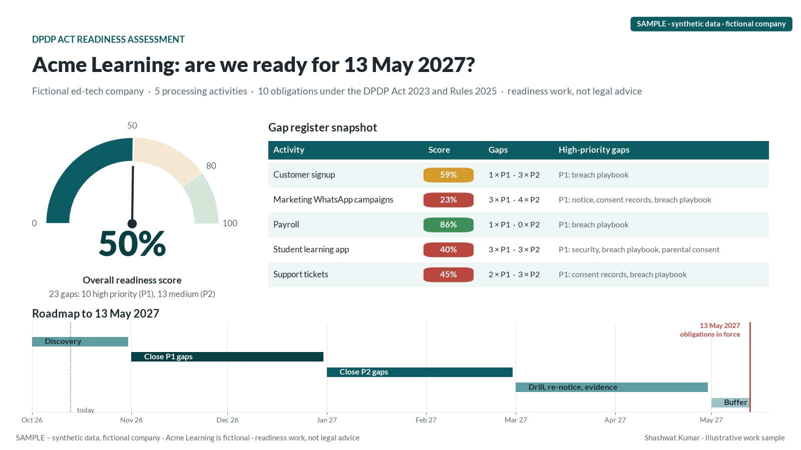
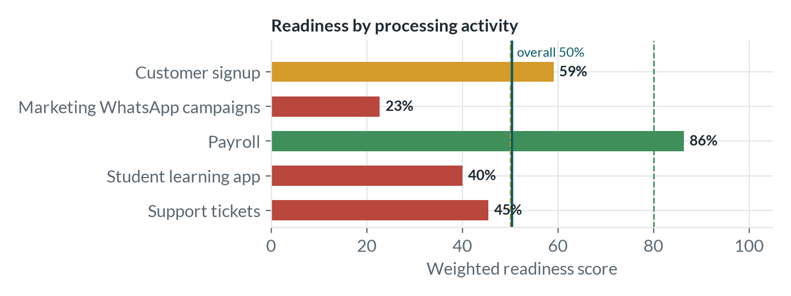

# dpdp-readiness-toolkit

**Readiness as a map, not a checklist.** A small, dependency-free scorer that reads a personal-data inventory and checks each processing activity against obligations under India's Digital Personal Data Protection Act 2023 and DPDP Rules 2025, plus a script that turns the result into a readable report.

> ⚠️ **Synthetic data, fictional organisation.** "Acme Learning" does not exist; the inventory is made up. This is a readiness aid for discussion, **not legal advice**. Check the official text and consult counsel.



## How it works

Each row of the inventory CSV is one processing activity. Yes/No columns (notice given, consent recorded, withdrawal as easy as consent, purpose defined, retention defined, processor contract, security controls, breach process, rights channel, and more) are weighted and mapped to the relevant section or rule. The scorer outputs an overall readiness score, a prioritised gap register with remediation notes, and per-activity scores.

On the bundled synthetic inventory it reports 50% readiness and 23 gaps.

| Path | What it is |
|---|---|
| `tool/dpdp_scorer.py` | Standard-library-only scorer: `python tool/dpdp_scorer.py inventory.csv report.md` |
| `tool/sample/SYNTHETIC_inventory.csv` | Example inventory (fictional) |
| `report/build_dpdp.py` | Runs the scorer and renders charts plus a PDF report |
| `report/figures/` | Activity scores, readiness gauge, roadmap |



## Run it

```bash
# scorer only, no dependencies
python tool/dpdp_scorer.py tool/sample/SYNTHETIC_inventory.csv out.md

# full report
python -m venv .venv && source .venv/bin/activate
pip install -r requirements.txt
python report/build_dpdp.py
```

## Related writing

- [DPDP Act 2023 and Rules 2025: a practical readiness guide](https://readsigil.com/insights/dpdp-act-readiness-guide.html)
- [Faster cars need better brakes](https://readsigil.com/essays/brakes.html)

MIT licensed.
